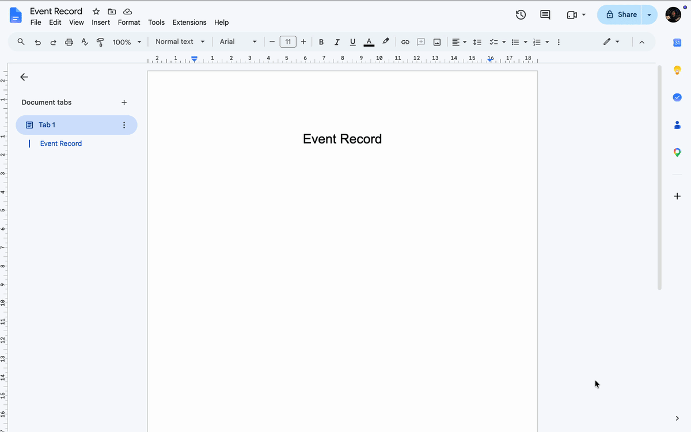
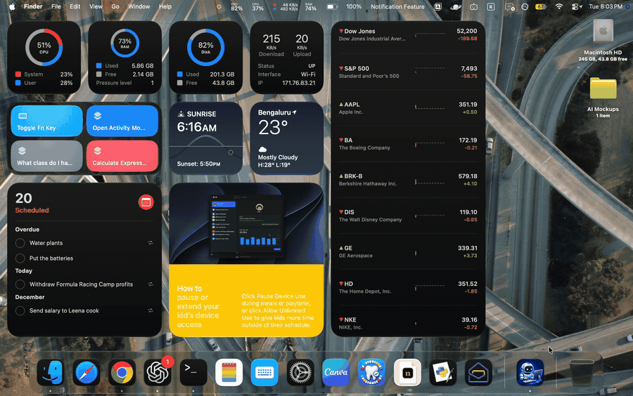
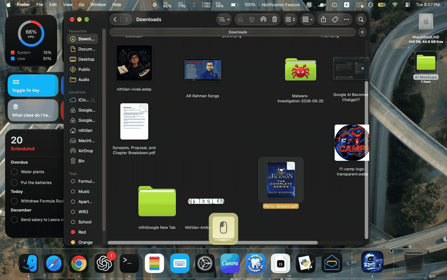
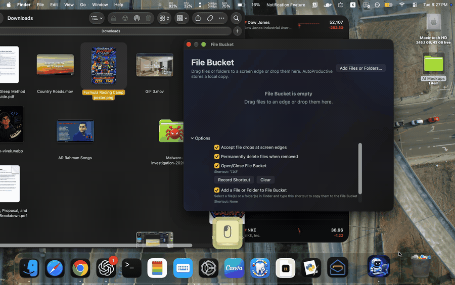

# AutoProductive for macOS

AutoProductive combines configurable automations with productivity tools for macOS. Create workflows using triggers and actions, and choose which optional tools and actions to install.

Download and learn more at [nithi.land](https://nithi.land/projects/autoproductive/). The [privacy policy](https://nithi.land/privacy/autoproductive/) describes local data, permissions, updates and optional problem reports.

## See AutoProductive in action

### Automating an email

### Writing an event record

### Switching browser windows

### Working in Finder

### Audio Mixer

### File Bucket

## Build

Open `AutoProductive.xcodeproj` in Xcode on macOS and build the AutoProductive scheme. The app targets macOS 14 or later. Development signing requires your own Apple development identity. Optional feature packages and updates require release catalogues signed with the corresponding update key; the private key is not included.

## License

AutoProductive source is licensed under the [MIT License](LICENSE). The bundled Sparkle framework is distributed under its own license in [Vendor/Sparkle-LICENSE](Vendor/Sparkle-LICENSE).
